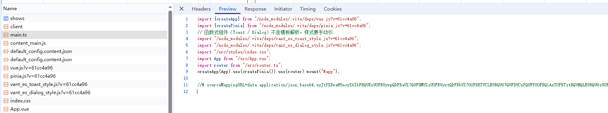

# Vite

本篇配两个工程，各管一半：

| 工程 | 是什么 | 用在哪 |
| --- | --- | --- |
| `./code/h5-vite/` | 「赴演记 H5」：Vue 3 + TS + Vue Router + Vant + Axios + Pinia，接真实后端 | 使用 & 核心模型、工程化 & 性能 |
| `./code/vite-lab/` | 插件实验工程：手写四个插件，把钩子逐个跑一遍 | 插件体系 |

## 使用 & 核心模型

### 核心设计思想

```
dev   浏览器 import ──请求──> Vite Server ──转译──> 返回 ESM 源码（不打包）
build 从 index.html 入口 ──全量解析──> 依赖图 ──打包 / 分割 / 压缩──> dist
```

| | dev | build |
| --- | --- | --- |
| 引擎 | esbuild（单文件转换）+ 依赖预构建 | Rolldown（兼容 Rollup 配置；8.x 默认） |
| 工作量 | 与「浏览器请求了什么」成正比 | 与项目规模成正比 |
| 产物 | 一个个真实 ESM 请求，不拼 bundle | chunk / asset，落盘到 `dist/` |
| 谁在用 | 本地开发 | 上线 |

两句话记住差异：

- **dev 处理的是被请求到的模块**：浏览器发一个 URL，server 才读文件、转译、返回；没被请求到的模块一次都不转。`ListView.vue` 被 `router.ts` import 了，但浏览器没请求它之前，server 不会处理它。
- **build 处理的是整个依赖图**：从 `index.html` 里的入口出发，全量走 `resolveId → load → transform`，再把图固化成 chunk。

dev 侧维护的结构叫**模块图**（module graph）：一个 URL 对应一个模块节点，节点上挂 `importers`（谁 import 我）与 `importedModules`（我 import 谁）。它解释了几个反直觉行为：

| 现象 | 原因 |
| --- | --- |
| 冷启动快 | 图只生长到「首屏请求到的那几条边」，其余节点待定 |
| HMR 快 | 只重转变更模块，再逆着 `importers` 找 accept 边界，不碰打包 |
| 源码必须是 ESM | dev 下 import 原样交给浏览器，CJS 必须先预构建 |

还有一个容易被忽略的约定：**Vite 的入口写在 HTML 里**。`index.html` 是构建起点，不是产物模板；下面这句就是 entry：


```html
<script type="module" src="/src/main.ts"></script>
```

### 基础使用

配置本身只有五类：

| 类别 | 作用与关键项 |
| --- | --- |
| 入口 | `root` 定位项目根，入口是 `index.html` 里的 `<script type="module">`，不是配置里的路径 |
| 出口 | `build.outDir`（默认 `dist`）；`rollupOptions.output.*FileNames` 决定产物命名 |
| 转换 | 内置按文件类型自动分流（TS / CSS / 图片）；`.vue`、JSX 这类语言文件交给官方语言插件 |
| 扩展 | `plugins` 数组，复用 Rollup 插件接口 |
| 优化 | `manualChunks` 分组、`minify` 压缩、`target` 兼容目标 |

下面是完整的生产参考配置：

```ts
const API_TARGET = 'https://api.show-track.top'
const proxy = {
    '/api': { target: API_TARGET, changeOrigin: true }
}

export default defineConfig(({ mode }) => ({
    plugins: [
        vue(),
        // Vue / Router / Pinia 的 API 免 import
        AutoImport({
            imports: ['vue', 'vue-router', 'pinia'],
            dts: 'src/auto-imports.d.ts'
        }),
        // 模板里写 <van-button> 即可；样式随组件按需注入
        Components({
            resolvers: [VantResolver()],
            dts: 'src/components.d.ts'
        }),
        // 产物另存一份 .gz，由 Nginx 直接送出
        compression({ threshold: 1024, ext: '.gz', deleteOriginFile: false })
    ],

    resolve: {
        alias: { '@': fileURLToPath(new URL('./src', import.meta.url)) }
    },

    // 只有 VITE_ 前缀的变量会进入客户端产物
    envPrefix: ['VITE_'],

    server: { proxy },
    preview: { proxy },

    // 生产构建去掉日志与断点
    esbuild: { drop: mode === 'production' ? ['console', 'debugger'] : [] },

    build: {
        target: 'es2020',
        outDir: 'dist',
        emptyOutDir: true,
        assetsInlineLimit: 4096,
        cssCodeSplit: true,
        sourcemap: false,
        rollupOptions: {
            output: {
                entryFileNames: 'assets/[name].[hash:8].js',
                chunkFileNames: 'assets/[name].[hash:8].js',
                assetFileNames: 'assets/[name].[hash:8][extname]',
                // 三方依赖按来源分组：任一业务改动都不会打乱它们的 hash
                manualChunks(id) {
                    if (!id.includes('node_modules')) return null
                    if (id.includes('node_modules/vant')) return 'vant'
                    if (id.includes('node_modules/axios')) return 'axios'
                    if (
                        id.includes('node_modules/vue') ||
                        id.includes('node_modules/@vue') ||
                        id.includes('node_modules/pinia')
                    ) {
                        return 'vue'
                    }
                    return 'vendor'
                }
            }
        }
    }
}))
```

这份配置里有四处是「生产才需要、模板项目不会给」的：

1. **`server.proxy` 与 `preview.proxy` 是两份**。代理只在本地服务器上生效，`dist/` 里没有任何转发逻辑；上线后由 Nginx 把 `/api` 反代到同一个后端。
2. **`manualChunks` 按来源拆三组**。`vant` 单独成 chunk 后，改一行业务代码不会让 155 kB 的组件库重新下载。
3. **`esbuild.drop` 只在 production 开**。dev 下保留 `console` 才能调试，build 前自动抹掉。
4. **`compression` 在构建末尾补 `.gz`**，静态服务器可直接送压缩文件，省掉运行时压缩。

五个路径 / 出口项要分清：

| 配置 | 默认值 | 作用 |
| --- | --- | --- |
| `root` | `process.cwd()` | 项目根；`index.html`、`.env*`、`public/` 都相对它解析 |
| `base` | `'/'` | 公共路径前缀，dev 与 build 都生效` |
| `publicDir` | `'public'` | 原样复制到产物根，用 `/logo.svg` 引用，不参与构建 |
| `build.outDir` | `'dist'` | 产物目录，相对 `root` |
| `build.rollupOptions` | `{}` | 直接透传给 Rollup / Rolldown：`input`、`output`、`plugins` 都在这里 |

`define` 替换的是**代码文本**，值必须 `JSON.stringify`——不加引号会被当成标识符而报错。本工程没有用 `define`，所有编译期注入都走环境变量，见下。

#### 环境变量

Vite 从 `.env` 文件读环境变量，**哪些文件被加载由 mode 决定**：

```
.env                  所有模式都加载
.env.development      只在 mode=development 时加载
.env.production       只在 mode=production 时加载
.env.local            本地覆盖，通常 gitignore
.env.[mode].local     优先级最高
```

**mode 怎么定**：`vite`（dev）默认 `development`，`vite build` 默认 `production`；用 `--mode` 显式指定任意值。mode 是 env 命中的开关——`vite build --mode staging` 会加载 `.env` + `.env.staging`（外加各自的 `.local` 变体），同时 `import.meta.env.MODE` 变成 `'staging'`。

同一变量在多份文件里出现时，**mode 专属 > 通用，`.local` > 非 `.local`**；已经存在的进程环境变量优先级最高。

读变量的入口是 `import.meta.env`，Vite 默认往里放五个内置常量——`MODE`（当前模式）、`DEV` / `PROD`（互斥布尔）、`BASE_URL`（就是 `base`）、`SSR`；`.env*` 文件里 `envPrefix`（默认 `VITE_`）前缀的变量也会进来。三条必须记住的规则：

1. **前缀是闸门**，防止把数据库密码打进前端产物。
2. **替换是字面量内联**，所以 `if (import.meta.env.PROD) {...}` 的假分支能被压缩器删掉。
3. **不能动态拼接 key**，构建期不知道 `key` 是什么，`import.meta.env[key]` 替换不了。

值的使用就两步：文件里声明，代码里读。

```bash
# .env.staging —— 为自定义模式准备的变量
VITE_API_BASE=https://staging.example.com
VITE_APP_TITLE=赴演记 (staging)
```

```ts
// 业务代码统一从 import.meta.env 读；变量没配时对象里根本没有这个 key，用 || 默认值兜底
const apiBase = import.meta.env.VITE_API_BASE || '/api'
const appTitle = import.meta.env.VITE_APP_TITLE
```

注意 `DEV` / `PROD` 由命令决定（`vite` 恒为 `DEV: true`，`vite build` 恒为 `PROD: true`），mode 名只是个标签——`--mode staging` 不会改变 `PROD` 的值。

#### 静态资源

| 写法 | 得到什么 | 典型用途 |
| --- | --- | --- |
| `import logo from './logo.svg'` | 一个 URL（小文件可能变 data URL） | 常规图片、字体 |
| `import logoUrl from './logo.svg?url'` | 始终是 URL，不受内联阈值影响 | 需要真实 URL 的场景 |
| `import text from './shader.glsl?raw'` | 文件内容字符串 | 着色器、模板、LICENSE |
| `import css from './a.css?inline'` | CSS 文本，不注入 `<style>` | 需要自己控制插入时机 |
| `import big from './big.png?no-inline'` | 强制不内联 | 调试内联阈值 |
| `/logo.svg`（放在 `public/`） | 原样复制的 URL | 不参与构建的静态文件 |

是否内联由 `build.assetsInlineLimit` 决定（默认 4096 字节）；`?inline` / `?no-inline` 可以显式覆盖它。

#### CSS

| 需求 | 写法 | 说明 |
| --- | --- | --- |
| 普通 CSS | `import './style.css'` | 产物里抽成独立 `.css` |
| CSS Modules | `import s from './a.module.css'` | `s.className` 是哈希后的类名 |
| Sass / Less | 装 `sass` / `less` 后直接 import `.scss` / `.less` | 预处理由对应编译器完成 |
| PostCSS | 根目录 `postcss.config.js` | 自动作用于所有 CSS |
| CSS 字符串 | `import css from './a.css?inline'` | 不注入，返回文本 |
| 按 chunk 拆分 | `build.cssCodeSplit: true`（默认） | 异步 chunk 的 CSS 随 chunk 加载 |

`.vue` 的编译不在内置转换里，必须装 `@vitejs/plugin-vue`——所谓「配置全手写」针对的是产物收尾，不是语言编译。

### 工程化 & 性能

#### 预构建（`optimizeDeps`）

- **为什么需要预构建**：`node_modules` 里的包大量是 CommonJS，浏览器不认；即使是 ESM，一个包也可能拆成几百个小文件，浏览器逐个请求会形成请求瀑布。预构建把依赖提前转成**单个 ESM 文件**并合并，一次解决两件事。

- 产物落在 `node_modules/.vite/deps/`，并带一份元数据`node_modules/.vite/deps/_metadata.json`：

```json
{
  "hash": "4652dcf8",
  "optimized": {
    "axios": { "src": "../../.pnpm/axios@1.21.1/node_modules/axios/index.js", "file": "axios.js" },
    "pinia": { "src": "../../.pnpm/pinia@3.0.4_.../node_modules/pinia/dist/pinia.mjs", "file": "pinia.js" },
    ...
  },
  "chunks": {
    "es-CqdtDXc6": { "file": "es-CqdtDXc6.js", "isDynamicEntry": false },
    "vue.runtime.esm-bundler-enJwGQ0A": { "file": "vue.runtime.esm-bundler-enJwGQ0A.js", "isDynamicEntry": false }
  }
}
```
dev 下 `main.ts` 的 import 会被改写成预构建产物：

- 裸导入会指向 `.vite/deps`，`?v=` 是预构建的缓存戳，依赖变了才会变，所以这一串 URL 可以被浏览器一直缓存到下次重新预构建
- 源码路径仍是 `/src/*` 原样返回



三个开关：

- `optimizeDeps.include`：显式声明要预构建的依赖。动态 import、插件内部引入的依赖可能扫不到，提前写死可以避免 dev 中途重新预构建并刷新页面。
- `optimizeDeps.exclude`：排除某个包。常见于本地 workspace 包——被预构建成一个文件后，这个节点对编辑不再敏感。
- `optimizeDeps.force` / `--force`：忽略缓存重新预构建。改完 `vite.config` 里依赖相关配置后用它。

统一演示：

```ts
// vite.config.ts
export default defineConfig({
    optimizeDeps: {
        // 扫描发现不了的依赖（动态 import、插件内部引入）显式声明，避免 dev 中途重新预构建
        include: ['esm-dep > cjs-dep'],
        // 本地 workspace 包不走预构建，保持源码引用、对编辑敏感
        exclude: ['@my/workspace-pkg']
    }
})
```

```bash
# 忽略缓存强制重新预构建（也可以删掉 node_modules/.vite 再起 dev）
vite --force
```

#### 依赖缓存（`node_modules/.vite`）

- 预构建产物不丢弃：它们连同 `_metadata.json` 一起缓存在 `node_modules/.vite/deps/`，下一次 `pnpm dev` 若判定「依赖没变」，直接用缓存、跳过预构建，冷启动更快。

- 判定依据是元数据里的 `hash`，它由这些输入算出来：lockfile 内容、patch-package 的 `patches/`、`vite.config` 里与依赖相关的字段（如 `resolve.alias`、`optimizeDeps.*`）、`NODE_ENV`。任一变了，hash 变，重新预构建。

缓存有**两层**：

| 层 | 位置 | 失效条件 |
| --- | --- | --- |
| server 侧 | `node_modules/.vite/deps/` | 上面的 hash 输入变化，或手动 `--force` |
| 浏览器侧 | HTTP 缓存 | 每个 deps 响应带 `Cache-Control: max-age=31536000, immutable`；靠 URL 里的 `?v=hash` 戳失效 |

排查「dev 起来还在用旧依赖」时，先删 `node_modules/.vite` 再 `--force` 起一遍，是万能复位键。

#### HMR

HMR 的原理仍然是「模块粒度 = 文件粒度」：服务端只重转变更模块，再通过 WebSocket 告诉浏览器重新发一个 ESM 请求，不需要重新打包，所以更新耗时与项目规模无关。

本工程一行 HMR 代码都没写，边界由 `@vitejs/plugin-vue` 生成：SFC 的 `<template>` 与 `<style>` 各有一条 accept 边，改模板只换渲染函数、改样式只换 `<style>` 标签。需要自己接管时再写：

```js
// 只在 dev 存在；build 时整段是死代码，会被摇掉
if (import.meta.hot) {
    import.meta.hot.accept(newModule => {
        // 用新模块替换旧模块，不刷新页面
    })
    import.meta.hot.dispose(data => {
        // 清理定时器 / 事件监听
    })
}
```

没有 `accept` 边界时会向上冒泡到 import 它的模块；一路冒泡不到就整页刷新。`import.meta.hot.invalidate()` 可以主动放弃当前模块、继续向上冒泡。

#### 构建优化

- **代码分割**：`build.rollupOptions.output.manualChunks` 按模块 id 分组；路由表里的 `() => import()` 自动切 chunk。
- **tree-shaking**：Rollup / Rolldown 的能力，前提是 ESM；包自己的 `sideEffects` 声明决定「没被引用的模块能不能整块删」。
- **压缩**：`build.minify` 默认 `'esbuild'`；要更激进的压缩可换 `'terser'`（需装 `terser`）。
- **兼容**：`build.target` 默认按浏览器基线（`baseline-widely-available`），要兼容旧浏览器时显式写 `es2015` / `es2017` 等。
- **资源内联**：`build.assetsInlineLimit` 控制小文件是否变 data URL。
- **CSS 拆分**：`build.cssCodeSplit` 让异步 chunk 的 CSS 随 chunk 加载。
- **组件按需**：`unplugin-vue-components` + `VantResolver` 让模板里的 `<van-button>` 自动 import 组件与样式；产物 CSS 里只有用到的组件。

四个关键项收进一个配置里：

```ts
// vite.config.ts
export default defineConfig({
    build: {
        // 兼容目标：默认 baseline-widely-available；要兼容旧浏览器时显式写 es2015 / es2017
        target: 'es2020',
        // 压缩器：默认 'esbuild'（更快）；要更激进的压缩可换 'terser'（需装 terser）
        minify: 'esbuild',
        // 异步 chunk 的 CSS 随 chunk 加载
        cssCodeSplit: true,
        rollupOptions: {
            output: {
                // manualChunks 按模块 id 分组——代码分割的主开关
                manualChunks(id) {
                    if (!id.includes('node_modules')) return null
                    if (id.includes('node_modules/vant')) return 'vant'
                    if (id.includes('node_modules/axios')) return 'axios'
                    if (
                        id.includes('node_modules/vue') ||
                        id.includes('node_modules/@vue') ||
                        id.includes('node_modules/pinia')
                    ) {
                        return 'vue'
                    }
                    return 'vendor'
                },
                // 想自定义 chunk 名在这里改，默认自带 hash
                chunkFileNames: 'assets/[name].[hash:8].js'
            }
        }
    }
})
```

路由级懒加载是最自然的分割点——路由表里写 `component: () => import('./views/ListView.vue')`，每个页面各一个 chunk。`import()` 是原生语法，不需要任何魔法注释，chunk 名直接取文件名。

一次 `pnpm build:only` 的产物（gzip 取 `dist/assets/*.gz` 的实测字节）：

```
✓ 452 modules transformed.
dist/index.html                       0.80 kB   未达压缩阈值
dist/assets/vant.39HXYg1r.js        154.99 kB │ gzip: 55.36 kB   ← 组件库 + Vue 运行时
dist/assets/vant.BAD5TRji.css        99.36 kB │ gzip: 37.79 kB   ← 用到的组件样式
dist/assets/axios.BDQnQehb.js        57.44 kB │ gzip: 20.58 kB   ← 请求库
dist/assets/vue.B-ghYvVV.js          30.93 kB │ gzip: 11.77 kB   ← vue-router + pinia
dist/assets/EditView.COBCXol3.js      5.95 kB │ gzip:  2.26 kB   ← 路由懒加载
dist/assets/ListView.B9ZFnnqn.js      4.95 kB │ gzip:  2.20 kB   ← 路由懒加载
dist/assets/index.CWmPoycl.js         4.93 kB │ gzip:  2.17 kB   ← 入口
dist/assets/StatsView.DmbXC73j.js     3.81 kB │ gzip:  1.75 kB
dist/assets/DetailView.CJeuOyVs.js    3.23 kB │ gzip:  1.61 kB
dist/assets/format.BPs43kNI.js        2.77 kB │ gzip:  1.53 kB   ← 共享工具
dist/assets/MineView.CmHZ86rE.js      2.41 kB │ gzip:  1.31 kB
dist/assets/index.CxpevrKH.css        0.90 kB   未达压缩阈值
dist/assets/*View.*.css            0.08～0.79 kB
dist/assets/show.L6ctyh5o.js          0.57 kB
dist/assets/stats.D6Q5HtaH.js         0.20 kB
dist/assets/rolldown-runtime.….js     0.16 kB
✓ built in 1.02s
11 个 .gz 合计 141.7 kB；算上未压缩的小文件与 HTML，整包 ≈ 147.1 kB
首屏（HTML + vue + vant + axios + 入口 + 列表页）≈ 135.5 kB
```

两组依赖的 hash 与业务代码无关：只改 `StatsView.vue`，`vant.39HXYg1r.js` 的文件名不变，CDN 缓存继续命中。`vant` 一组占了总量的一半以上，这是组件库的固定成本；继续压只能减少用到的组件，而不是换压缩器。

分组边界还有一处值得记住：名字叫 `vue` 的那个 chunk 里只有 `vue-router` 与 `pinia`，**Vue 运行时被归进了 `vant` chunk**。`manualChunks` 表达的是「我希望怎么分」，最终落点是打包器的模块归属规则；配了函数不等于拿到的分组和函数字面一一对应。

`vite-plugin-compression` 在同一个 `dist/assets/` 里再写 11 个 `.gz`（`deleteOriginFile: false` 保留原文件，方便对比）。构建日志里它打印的是带盘符的拼接路径，那只是 Windows 下的日志格式问题，产物位置是对的。

#### 产物分析

上面的产物表肉眼可读，但增量对比需要工具。生态里最常用的是 `rollup-plugin-visualizer`：当普通插件加进 `plugins`，构建结束生成一份 `stats.html` 的 treemap——矩形面积即体积（可按 gzip 计算），能直接看出「哪个包占掉了产物的大头」，再回头调整 `manualChunks` 或按需引入策略。本工程已接入（`vite.config.ts` 里一行 `visualizer({ filename: 'stats.html', gzipSize: true })`），`pnpm build` 后打开项目根目录的 `stats.html` 即可；报告写在根目录而不是 `dist/`，是因为 `dist/` 里的 `.html` 会被 compression 插件误压一份 `.gz`。

看图时两个提醒：

1. 面积大的包不等于「该删」——组件库这种固定成本看的是「用到了多少」，该优化的是按需引入，不是换包。
2. 想持续盯着增量，把「量 gzip + 阈值告警」做成构建门禁更实际，见插件篇的 `mini-size-gate`。

## 插件体系

使用篇里的插件全是现成的（`@vitejs/plugin-vue`、两个 unplugin、compression）。这一节换到 `./code/vite-lab`，手写四个插件，把钩子的触发时机、参数与顺序看清。

### 插件结构

一个插件就是一个对象；唯一必填字段是 `name`，其余全是钩子：

```ts
type Plugin = {
  name: string
  // Vite 专属（dev server 阶段）
  configureServer(server): void
  configurePreviewServer(server): void
  transformIndexHtml(html, ctx)
  // 通用（dev + build 都执行，来自 Rollup / Rolldown）
  options, buildStart, resolveId, load, transform, buildEnd
  // 输出阶段（只有 build 才有）
  renderChunk, generateBundle
}
```

Vite 的钩子有**两条正交的轴**：**归属**（通用还是 Vite 专有）与**生效端**（dev / build / 两者 / preview）。判「能不能换个工具复用」看归属，判「什么时候触发」看生效端。

#### 通用钩子（Rollup / Rolldown 兼容）

| 钩子 | 参数 | 生效端 | 此刻能看到 | 本篇谁在用 |
| --- | --- | --- | --- | --- |
| `buildStart` | `(options)` | 两者 | 已解析的 options | — |
| `resolveId` | `(source, importer)` | 两者 | 说明符、importer | `mini-virtual` |
| `load` | `(id)` | 两者 | 已解析的 id | `mini-virtual` |
| `transform` | `(code, id)` | 两者 | 源码 + id | —（返回新 code 即替换源码） |
| `buildEnd` | `(error?)` | 两者 | 构建结束 / 报错 | — |
| `renderChunk` | `(code, chunk)` | **build** | 已生成的 chunk 代码 | —（分工见「三个钩子的分工纪律」） |
| `generateBundle` | `(options, bundle)` | **build** | 完整 bundle | `mini-size-gate` |
| `closeBundle` | `()` | **build** | 已写盘的产物 | — |

#### Vite 专有钩子

| 钩子 | 参数 | 生效端 | 用途 | 本篇谁在用 |
| --- | --- | --- | --- | --- |
| `config` | `(config, env)` | 两者 | 改配置（返回 partial） | — |
| `configResolved` | `(config)` | 两者 | 读最终配置 | `mini-virtual`（缓存 `mode`） |
| `configureServer` | `(server)` | **dev** | 加中间件、WebSocket | `mini-mock` |
| `configurePreviewServer` | `(server)` | **preview** | 预览期中间件 | — |
| `transformIndexHtml` | `(html, ctx)` | 两者 | 改 HTML（build 侧有 `ctx.bundle`） | `mini-html` |
| `hotUpdate` | `(ctx)` | **dev** | 热更新时介入模块集合 | —（原理见「HMR」） |

三条读表纪律：

1. **「两端都跑」不等于「含义相同」**。`resolveId` / `load` / `transform` 在 dev 只处理被请求到的模块，在 build 处理整张依赖图。
2. **不是所有钩子都会在你的项目里跑**。`configurePreviewServer` 只在 `vite preview` 时触发；表里的空行也是信息。
3. **钩子不触发先查 `apply`**。`apply: 'serve'` 的插件在 build 里根本不加载。

### 顺序与门禁

Vite 的排序分三层：

| 层 | 手段 | 作用范围 | 例子 |
| --- | --- | --- | --- |
| 1 | 不用排 | 跨钩子 | `resolveId → load → transform` 天然有先后 |
| 2 | `enforce: 'pre' \| 'normal' \| 'post'` | **跨插件、同一个钩子** | 想抢在内置转换前看源码就用 `pre` |
| 3 | `order: 'pre' \| 'normal' \| 'post'` | **同插件、同一钩子的多个 handler** | `mini-html` 的 `transformIndexHtml: { order: 'post', handler }` |

官方顺序链：

```
alias → pre → vite core → normal → vite build → post → vite build post
```

三层能表达「我在内置之前 / 之后」；需要更细的控制时，把逻辑挪到更早或更晚的钩子里，而不是靠排序硬挤。

门禁一律用 `apply`，不要在钩子里判 `command`：

```js
// build 才加载；dev 下这个插件根本不存在
{ name: 'my-plugin', apply: 'build', transform(code, id) { /* … */ } }
```

写成钩子体内 `if (command === 'build')`，插件在另一端仍会被加载、`config` 仍会被调用，只是钩子体不干活。

### 插件实战：四个钩子各写一个

四个插件覆盖四类最常用的钩子。先给一个最小骨架——**插件的全部接口就是「返回一个对象，在对象上挂钩子」**：

```js
export default function myPlugin(options = {}) {
    return {
        name: 'my-plugin',      // 唯一必填，且要唯一
        apply: 'build',        // dev / build 门禁
        enforce: 'pre',        // 跨插件排序
        transform(code, id) {
            if (!id.endsWith('.js')) return null // 返回 null = 不处理
            return { code: code.replace(/console\.log\([^)]*\)/g, '') }
        }
    }
}
```

#### `mini-virtual`：`resolveId` + `load`

源码里 `import { BUILD_INFO } from 'virtual:build-info'`，磁盘上没有这个文件。虚拟模块靠两个钩子配合：`resolveId` 认领说明符、`load` 提供内容。

> 摘自 `./code/vite-lab/plugins/mini-virtual.mjs`（运行：`npm run build`）

```js
export default function miniVirtual() {
    const VIRTUAL_ID = 'virtual:build-info'
    const RESOLVED_ID = '\0' + VIRTUAL_ID

    // configResolved 能读到最终配置；把 mode 缓存下来，load 时注入字面量
    let mode = 'production'

    return {
        name: 'mini-virtual',

        configResolved(config) {
            mode = config.mode
        },

        resolveId(source) {
            if (source === VIRTUAL_ID) return RESOLVED_ID
            return null // 返回 null = 这个模块我不管，交给链上的下一个插件
        },

        load(id) {
            if (id !== RESOLVED_ID) return null
            // 这里返回的就是"模块源码"，它会像真实文件一样被后续插件 transform
            return `export const BUILD_INFO = { name: 'vite-lab', mode: ${JSON.stringify(mode)} }\n`
        }
    }
}
```

三个关键点：

1. **虚拟 id 用 `\0` 打头**。这是社区约定，表示「不是真实路径」，避免后续插件或解析器再去磁盘找它。
2. **`resolveId` 返回 `null` 表示「我不处理」**，把说明符交还给插件链。
3. **`load` 返回的字符串就是源码**，它会继续流经后续 `transform`，也能被 tree-shaking。

dev 下同样有效：请求 `virtual:build-info` 会走一遍 `resolveId → load → transform`，URL 被编码成 `/@id/__x00__virtual:build-info`。

#### `mini-mock`：`configureServer`

页面里 `fetch('/api/user')`，请求由中间件直接应答，背后没有真实后端。插件声明 `apply: 'serve'`，build 时根本不加载。

> 摘自 `./code/vite-lab/plugins/mini-mock.mjs`（运行：`npm run dev`）

```js
export default function miniMock(options = {}) {
    const data = options.data || {
        '/api/user': { id: 1, name: 'vite-lab', role: 'admin' },
        '/api/pages': [
            { path: '/', title: '首页' },
            { path: '/about', title: '关于' }
        ]
    }

    return {
        name: 'mini-mock',
        apply: 'serve',

        configureServer(server) {
            server.middlewares.use((req, res, next) => {
                const url = req.url?.split('?')[0]
                if (!url?.startsWith('/api/')) return next()

                const hit = data[url]
                res.statusCode = hit ? 200 : 404
                res.setHeader('Content-Type', 'application/json; charset=utf-8')
                res.end(JSON.stringify(hit || { error: 'mock 未定义该接口' }))
                console.log(`  [mini-mock] ${req.method} ${url} → ${res.statusCode}`)
            })

            // 返回的函数排在 Vite 内置中间件之后，适合做收尾动作（这里打印注册表）
            return () => {
                const routes = Object.keys(data)
                console.log(`  [mini-mock] 已注册 ${routes.length} 条 mock 路由：${routes.join(', ')}`)
            }
        }
    }
}
```

两个要点：

1. **中间件有两种挂法，差别是「排在内置中间件之前还是之后」**。直接 `server.middlewares.use()` 是立刻挂；`return () => {...}` 是交给 Vite 等内置中间件装完再调用。
2. **这个差别有后果**：`/api/*` 的 404 必须放在靠前那个中间件里。写到返回的函数里，浏览器发来的 `/api/nope` 带 `Accept: text/html`，会被更靠前的 HTML 回退先吞成 `index.html`（状态码 200）。

实测（`npm run dev`，另开终端发请求）：

```
  [mini-mock] 已注册 2 条 mock 路由：/api/user, /api/pages
  [mini-mock] GET /api/user → 200
  [mini-mock] GET /api/nope → 404
```

```
$ curl http://localhost:5182/api/user
{"id":1,"name":"vite-lab","role":"admin"}
```

#### `mini-html`：`transformIndexHtml`

`apply: 'build'` + `order: 'post'`，保证只在构建期、且在其它 HTML 变换之后执行。

> 摘自 `./code/vite-lab/plugins/mini-html.mjs`（运行：`npm run build`）

```js
export default function miniHtml(options = {}) {
    const nonce = options.nonce || 'lab-nonce'

    return {
        name: 'mini-html',
        apply: 'build',

        transformIndexHtml: {
            order: 'post',
            handler(html, ctx) {
                // ctx.bundle 只有构建期才有：里面是「文件名 → 产物」的映射
                const entry = Object.values(ctx.bundle).find(o => o.type === 'chunk' && o.isEntry)

                // Vite 默认已经注入过 modulepreload，不查重会让同一个 chunk 被请求两次
                const deps = entry?.imports || []
                const missing = deps.filter(f => !html.includes(`href="/${f}"`))
                const preloads = missing
                    .map(f => `<link rel="modulepreload" href="/${f}" nonce="${nonce}">`)
                    .join('\n    ')

                const withNonce = html.replace(/<script /g, `<script nonce="${nonce}" `)
                console.log(
                    `  [mini-html] 入口依赖 ${deps.length} 条，Vite 已注入 ${deps.length - missing.length} 条，补 ${
                        missing.length
                    } 条；脚本加 nonce="${nonce}"`
                )

                return preloads ? withNonce.replace('</head>', `    ${preloads}\n  </head>`) : withNonce
            }
        }
    }
}
```

**「补 0 条」是本段最有价值的读数**：Vite 默认已经注入了 `modulepreload`，自研插件不查重就会让同一个 chunk 被请求两次。

```
  [mini-html] 入口依赖 1 条，Vite 已注入 1 条，补 0 条；脚本加 nonce="lab-nonce"
```

生成的 `dist/index.html`：

```html
<!doctype html>
<html lang="zh-CN">
    <head>
        <meta charset="UTF-8" />
        <meta name="viewport" content="width=device-width, initial-scale=1" />
        <title>vite-lab 生产构建</title>
      <script nonce="lab-nonce" type="module" crossorigin src="/assets/index.DBSKlWm-.js"></script>
      <link rel="modulepreload" crossorigin href="/assets/vendor.DsOb2RQy.chunk.js">
      <link rel="stylesheet" crossorigin href="/assets/index.Ci2kpolT.css">
    </head>
```

`<script>` / `<link>` 引用的是**现读出来的最终文件名**——hash 变了它自动跟着变，所以从不手写 `<script src="app.js">`。

#### `mini-size-gate`：`generateBundle`

`generateBundle` 是「已生成、未写盘」的唯一安全窗口：此时能读到最终代码，也能增删产物。

> 摘自 `./code/vite-lab/plugins/mini-size-gate.mjs`（运行：`npm run build`）

```js
import zlib from 'node:zlib'

export default function miniSizeGate({ limitKb = Infinity, manifest = 'build-manifest.json' } = {}) {
    return {
        name: 'mini-size-gate',

        generateBundle(_options, bundle) {
            const rows = []
            for (const [fileName, item] of Object.entries(bundle)) {
                const source = item.type === 'chunk' ? item.code : item.source
                rows.push({
                    fileName,
                    type: item.type,
                    raw: Buffer.byteLength(source),
                    gzip: zlib.gzipSync(Buffer.from(source)).length
                })
            }
            rows.sort((a, b) => b.gzip - a.gzip)

            console.log('  ---- 产物清单（按 gzip 排序）----')
            for (const r of rows) {
                console.log(
                    `    ${r.fileName.padEnd(32)} ${r.type.padEnd(6)} raw ${String(r.raw).padStart(6)}B  gzip ${String(
                        r.gzip
                    ).padStart(6)}B`
                )
            }

            // emitFile：额外产出一个清单文件（走 asset 通道，不占 chunk）
            this.emitFile({
                type: 'asset',
                fileName: manifest,
                source: JSON.stringify(rows, null, 2)
            })

            const over = rows.filter(r => r.gzip > limitKb * 1024)
            if (over.length) {
                this.error(`产物超预算：${over.map(r => `${r.fileName} gzip ${r.gzip}B > ${limitKb}KB`).join('；')}`)
            }
            console.log(`    合计 gzip ${rows.reduce((s, r) => s + r.gzip, 0)}B，预算 ${limitKb}KB —— 通过`)
        }
    }
}
```

三个设计点：

1. **量 gzip 而不是 raw**。浏览器拿到的都是压缩后的字节，raw 与 gzip 差 3 倍很常见。
2. **产出清单而不是只打印**。构建日志会丢，`build-manifest.json` 会进 CI 产物；下次体积涨了，diff 两份清单就知道是哪个 chunk 涨的。
3. **`this.error` 让插件从「报告」变成「门禁」**。CI 里的非零退出码就是靠它。

`vite-lab` 的一次构建合计 gzip 42309B，预算 60KB —— 通过。阈值是「挡住继续膨胀」，不是脱离技术栈的绝对值。

### 三个钩子的分工纪律

build 侧最后三道工序该挂在哪，是实操里最容易选错的：

| 想干的事 | 用哪个钩子 | 为什么是它 |
| --- | --- | --- |
| 改 chunk 代码（压缩、替换常量） | `renderChunk` | 代码已生成、hash 未算、未写盘 |
| 增删产物、改文件名、产出清单 | `generateBundle` | 「已生成、未写盘」的唯一安全窗口 |
| 改 HTML | `transformIndexHtml` | 只有它拿得到 `ctx.bundle`（build 侧） |
| 按源码逐模块改写 | `transform` | 拿得到 `code` 与 `id`，拿不到 bundle |

一句话：**改代码在 `renderChunk`，动产物结构在 `generateBundle`，改 HTML 在 `transformIndexHtml`**。删一个 chunk 时还要留意它的引用边，否则别的 chunk 会指向一个不存在的文件。

本篇插件与生态插件的对照：

| lab 插件 | 挂的钩子 | 对应的真实插件 | 什么时候直接用现成的 |
| --- | --- | --- | --- |
| `mini-virtual` | `resolveId` + `load` | `vite-plugin-virtual` | 只是要个虚拟常量，用现成的更省 |
| `mini-mock` | `configureServer` | `vite-plugin-mock` | 要延时 / 分页 / 数据文件，用现成的 |
| `mini-html` | `transformIndexHtml` | `vite-plugin-html` | 要 EJS 模板 / 多页注入，用现成的 |
| `mini-size-gate` | `generateBundle` | `size-limit` | 门禁要接 CI 报告，现成的更全 |

一条总纲：**语言编译一律用官方（`@vitejs/plugin-vue`）；产物收尾才值得自己写；生态里已有成熟插件时优先用现成的。**

## 配套代码

两个独立工程，各自 `pnpm install` 后即可运行。

### h5-vite

「赴演记 H5」：Vue 3 + TypeScript + Vue Router + Vant + Axios + Pinia，接真实后端 `https://api.show-track.top`，只做核心闭环五页（列表 / 详情 / 新增 + 编辑 / 统计 / 我的）。

| 文件 | 作用 | 对应小节 |
| --- | --- | --- |
| `./code/h5-vite/package.json` | 五个命令：`dev` / `build` / `build:only` / `preview` / `typecheck` | 基础使用 |
| `./code/h5-vite/vite.config.ts` | **唯一配置**：插件、代理、分组、hash、压缩 | 基础使用、构建优化 |
| `./code/h5-vite/index.html` | 入口（Vite 的 entry 写在 HTML 里） | 核心设计思想 |
| `./code/h5-vite/.env`、`.env.development`、`.env.production` | 环境变量（`VITE_APP_TITLE` 按 mode 变） | 环境变量 |
| `./code/h5-vite/.env.local.example` | token 模板（复制为 `.env.local`，已被 gitignore） | 环境变量 |
| `./code/h5-vite/src/env.ts` | 环境变量收口，全项目唯一读 `import.meta.env` 的地方 | 环境变量 |
| `./code/h5-vite/src/main.ts` | 入口脚本：Pinia、Router、Vant 函数式样式 | CSS |
| `./code/h5-vite/src/router.ts` | 五条路由 + `() => import()` 懒加载 | 构建优化 |
| `./code/h5-vite/src/views/shows/` | 列表 / 详情 / 新增+编辑（Vant List、DropdownMenu、Form、DatePicker） | 工程化 & 性能 |
| `./code/h5-vite/src/views/stats/`、`views/mine/` | 统计页（进度条 + Top10）、我的页（运行信息） | 工程化 & 性能 |
| `./code/h5-vite/src/api/` | `client.ts`（拦截器 + 响应解包）+ `show` / `stats` / `user` | 工程化 & 性能 |
| `./code/h5-vite/src/stores/me.ts` | Pinia store：profile + 概览，`Promise.all` 并发 | 工程化 & 性能 |
| `./code/h5-vite/src/utils/format.ts` | 金额、费用口径、艺人文本、海报地址、日期倒计时 | 环境变量、静态资源 |
| `./code/h5-vite/src/components/ShowCard.vue` | 列表卡片 | — |
| `./code/h5-vite/src/styles/index.css` | 全局样式（安全区、页面留白） | CSS |

运行：

```bash
cd code/h5-vite
pnpm install
cp .env.local.example .env.local   # 填入 VITE_API_TOKEN
pnpm dev        # 默认 http://localhost:5173（被占用自动 +1）
pnpm build      # 类型检查 + 产物到 dist/
pnpm preview    # 先 build 再预览，默认 http://localhost:4173
```

### vite-lab

插件实验工程：单入口 + 四个手写插件 + 路由懒加载，用来看钩子什么时候触发。

| 文件 | 作用 | 对应小节 |
| --- | --- | --- |
| `./code/vite-lab/package.json` | 三个命令：`dev` / `build` / `preview` | 插件实战 |
| `./code/vite-lab/vite.config.mjs` | **唯一配置**：四个手写插件 + `manualChunks` + 体积门禁 | 插件实战、三个钩子的分工纪律 |
| `./code/vite-lab/index.html` | 入口 | 核心设计思想 |
| `./code/vite-lab/src/main.js` | 环境变量、虚拟模块、真实 npm 依赖 | 插件实战 |
| `./code/vite-lab/src/App.vue`、`src/views/`、`src/components/` | SFC 根组件 + 两个路由视图 + 卡片组件 | 插件实战 |
| `./code/vite-lab/src/router.js` | 路由表：`() => import()` 路由级懒加载 | 构建优化 |
| `./code/vite-lab/src/style.css`、`src/base.css`、`src/helper.js` | 样式（`@import`）与工具函数样本 | CSS |
| `./code/vite-lab/.env`、`.env.production` | 环境变量（`VITE_APP_NAME`） | 环境变量 |
| `./code/vite-lab/plugins/mini-virtual.mjs` | 虚拟模块（`resolveId` + `load`） | `mini-virtual` |
| `./code/vite-lab/plugins/mini-mock.mjs` | dev 期 mock API（`configureServer`） | `mini-mock` |
| `./code/vite-lab/plugins/mini-html.mjs` | HTML 收尾（`transformIndexHtml`） | `mini-html` |
| `./code/vite-lab/plugins/mini-size-gate.mjs` | 体积门禁 + 清单（`generateBundle`） | `mini-size-gate` |

运行：

```bash
cd code/vite-lab
npm install
npm run dev       # http://localhost:5182
npm run build
npm run preview   # http://localhost:5181
```

