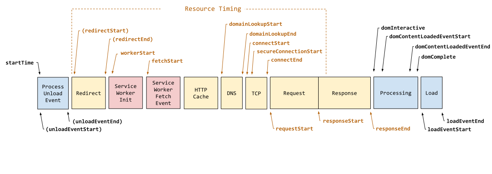

## 加载链路主线（基础）

### 从输入 URL 到页面加载完成



1. 卸载原页面并重定向到新页面：浏览器会准备一个`渲染进程`用于渲染即将到来的页面，和一个`网络进程`用于发送网络请求
2. 处理service worker：如果当前页面注册了Service Worker那么它可以拦截当前网站所有的请求，进行判断是否需要向远程发送网络请求
3. 网络请求阶段
   1. 缓存判断：
      1. 强缓存判断
      2. 强缓存不可用，等下方建立好连接再进行协商缓存判断（之前响应有返回etag、last-modify）

   2. DNS 解析IP：
      1. 本地缓存→系统缓存→本地域名服务器
      2. 本地服务器迭代→(根/顶级/权威服务器)

   3. TCP+TLS连接
      1. TCP 三次握手：确认双方收发能力，携带初始序列号
      2. HTTPS 再做 TLS 握手：非对称加密交换密钥、之后对称加密传输

   4. 发送 HTTP 请求与响应

4. 浏览器渲染阶段：解析 HTML/CSS 构建 DOM/CSSOM → 合成渲染树 → 布局（计算几何位置）→ 绘制 → 合成上屏

### 常见优化手段
1. **网络层｜目标：降低往返延迟、提升传输效率**
   1. 静态资源接入 CDN
   2. HTML no-cache 配置协商缓存；带hash长缓存
   3. preconnect / dns-prefetch 预连接域名，提前加载关键资源：preload
   4. 使用 HTTP2 / HTTP3

   ```html
   <!-- 3. 预连接域名 + 提前加载关键资源 -->
   <link rel="preconnect" href="https://cdn.example.com" crossorigin>
   <link rel="dns-prefetch" href="https://static.example.com">
   <!-- 提前加载首屏关键资源（字体/首屏脚本） -->
   <link rel="preload" href="/assets/main.3f2a1b.js" as="script">
   <link rel="preload" href="/fonts/inter.woff2" as="font" type="font/woff2" crossorigin>

   <!-- 2/4. nginx.conf：HTML no-cache 走协商缓存；带 hash 的资源长强缓存；开启 HTTP2 -->
   location = /index.html {
     add_header Cache-Control "no-cache";
   }
   location ~* \.(js|css|png|svg|woff2)$ {
     add_header Cache-Control "max-age=31536000, immutable";
   }
   listen 443 ssl http2;
   ```

2. **资源层｜目标：调度资源优先级，让关键资源更快抵达**
   1. 减少产物体积：Tree Shaking、组件库按需加载
   2. 只加载必要资源：路由懒加载、组件异步加载、图片懒加载
   3. 第三方包单独分包

   ```ts
   // 1. Tree Shaking：具名导入替代整包引入
   import { debounce } from 'lodash-es'   // ✅ 只打包 debounce
   import _ from 'lodash'                 // ❌ 打包整个 lodash

   // 1. 组件库按需引入（Vite + unplugin-vue-components 自动按需）
   // vite.config.ts
   import Components from 'unplugin-vue-components/vite'
   import { ElementPlusResolver } from 'unplugin-vue-components/resolvers'
   export default {
     plugins: [Components({ resolvers: [ElementPlusResolver()] })]
   }

   // 2. 路由懒加载：访问到该路由才下载对应 chunk
   const routes = [
     { path: '/detail', component: () => import('./views/Detail.vue') }
   ]

   // 2. 组件异步加载：弹窗/图表等非关键组件用到时才加载
   import { defineAsyncComponent } from 'vue'
   const HeavyChart = defineAsyncComponent(() => import('./HeavyChart.vue'))

   // 2. 图片懒加载：进入视口才发起请求
   // 

   // 3. 第三方包单独分包：稳定依赖不参与业务 chunk 的 hash 变化，命中长缓存
   // vite.config.ts
   export default {
     build: {
       rollupOptions: {
         output: {
           manualChunks: {
             vue: ['vue', 'vue-router', 'pinia'],
             echarts: ['echarts']
           }
         }
       }
     }
   }
   ```

3. **渲染 / 运行时｜目标：降低渲染开销，稳定布局，控制 CLS**
   1. 框架-vue
      1. 状态下沉：将状态放到使用它的最小组件，缩小变更影响范围，避免顶层状态连带大量无关组件重渲染
      2. v-memo：缓存模板子树，依赖不变跳过 diff
      3. v-once：静态内容只渲染一次
      4. `shallowRef / shallowReactive`：大型数据关闭深层响应，降低代理开销
      5. 收敛 watch：精确监听字段，避免不必要 deep，及时销毁 watch
      6. 使用 `computed` 缓存昂贵派生计算
      7. Props 精简、保持引用稳定，不传递完整大对象
      8. 动静组件拆分，隔离高频更新区域
   2. 长列表使用虚拟列表
   3. 稳定布局、低成本动画
      1. 动画只用 `transform`、`opacity`，走合成层
      2. 动态内容提前预留容器尺寸，防止 CLS

   ```vue
   <script setup>
   // 1.4 shallowRef：大列表关闭深层响应式代理，降低开销
   import { shallowRef, triggerRef, computed, watch } from 'vue'
   const bigList = shallowRef([])
   bigList.value = await fetchList()
   triggerRef(bigList)          // 内部字段被外部修改时，手动触发更新

   // 1.5 收敛 watch：精确监听字段，避免 deep 全量监听
   watch(() => form.keyword, kw => search(kw))    // ✅ 只在 keyword 变化时触发
   watch(form, cb, { deep: true })                // ❌ 任意字段变化都会触发

   // 1.6 computed 缓存昂贵派生计算：依赖不变直接返回缓存结果
   const filteredList = computed(() =>
     bigList.value.filter(i => i.score > 60)
   )

   // 1.7 Props 精简、引用稳定：只传所需字段，用 computed 保持引用稳定
   // ❌ <Child :data="{ name: user.name, items: user.items }" /> 每次渲染都是新对象
   const childProps = computed(() => ({ name: user.name, items: user.items }))
   // ✅ <Child :data="childProps" /> 依赖不变时 computed 返回同一引用

   // 2. 虚拟列表：只渲染可视区条目，1w+ 条数据也只挂载几十个 DOM
   import { useVirtualList } from '@vueuse/core'
   const { list, containerProps, wrapperProps } = useVirtualList(bigData, {
     itemHeight: 48,   // 每行固定高度
     overscan: 5       // 视口外预渲染行数，滚动更平滑
   })
   </script>

   <template>
     <!-- 1.1 状态下沉：状态放到只依赖它的最小组件，顶层状态变化不再连带整页重渲染 -->
     <!-- ❌ keywords 放顶层 store，输入一次整个页面全部重渲染 -->
     <!-- ✅ keywords 下沉到搜索结果组件内部自己维护 -->

     <!-- 1.2 v-memo：selected 不变时跳过该子树的 diff -->
     <div v-for="item in list" :key="item.id" v-memo="[item.selected]">
       <span>{{ item.name }}</span>
       <HeavyComp :data="item" />
     </div>

     <!-- 1.3 v-once：静态内容只渲染一次，后续更新直接跳过 -->
     <header v-once>
       <h1>网站标题</h1>
     </header>

     <!-- 1.8 动静组件拆分：高频更新的动态区独立成小组件，静态区不跟着重渲染 -->
     <StaticBanner />
     <RealtimePrice :id="id" />

     <!-- 2. 虚拟列表容器 -->
     <div v-bind="containerProps" style="height: 600px; overflow: auto;">
       <div v-bind="wrapperProps">
         <div v-for="{ data } in list" :key="data.id" :style="{ height: '48px' }">{{ data.name }}</div>
       </div>
     </div>
   </template>

   <style>
   /* 3.1 动画只用 transform / opacity：走合成层，不触发重排重绘 */
   .card { transition: transform .3s, opacity .3s; }
   .card:hover { transform: translate3d(0, -4px, 0); opacity: .9; }
   /* ❌ 触发 layout 的属性：width / height / top / left / margin */

   /* 3.2 动态内容提前预留尺寸，防止 CLS */
   .banner { aspect-ratio: 16 / 9; }   /* 图片加载前就占好位置 */
   .ad-slot { min-height: 250px; }     /* 广告/卡片加载前占位 */
   img { width: 100%; height: auto; }
   </style>
   ```

4. **交互层｜目标：保护主线程，保证 INP，响应及时**
   1. 优化长任务：长任务使用 MessageChannel 切片、密集计算使用 web worker
   2. 防抖、节流
   3. `requestIdleCallback` 延迟挂载非关键组件
   4. 及时清理定时器、请求订阅、事件监听，避免内存泄漏

   ```ts
   // 1. 长任务切片：把大任务切成 <50ms 的小块，块间让出主线程，避免阻塞输入响应
   function runInChunks(tasks: (() => void)[]) {
     let i = 0
     const channel = new MessageChannel()
     channel.port2.onmessage = function step() {
       const start = performance.now()
       while (i < tasks.length && performance.now() - start < 40) {
         tasks[i++]()                          // 一帧内最多跑 40ms
       }
       if (i < tasks.length) channel.port1.postMessage(null) // 剩余任务下一帧继续
     }
     channel.port1.start?.()
     step()
   }

   // 1. 密集计算放 Web Worker：主线程不阻塞，输入响应不受影响
   const worker = new Worker(new URL('./heavy.worker.ts', import.meta.url))
   worker.postMessage(rawData)
   worker.onmessage = e => render(e.data)

   // 2. 防抖：停止触发 n ms 后才真正执行（搜索输入）
   function debounce<T extends (...args: any[]) => void>(fn: T, delay = 300) {
     let timer: ReturnType<typeof setTimeout>
     return (...args: Parameters<T>) => {
       clearTimeout(timer)
       timer = setTimeout(() => fn(...args), delay)
     }
   }
   // 2. 节流：n ms 内最多执行一次（scroll / resize / mousemove）
   function throttle<T extends (...args: any[]) => void>(fn: T, interval = 200) {
     let last = 0
     return (...args: Parameters<T>) => {
       const now = Date.now()
       if (now - last >= interval) { last = now; fn(...args) }
     }
   }

   // 3. requestIdleCallback：浏览器空闲时再挂载非关键组件，不抢占首屏
   function mountWhenIdle(cb: () => void) {
     if ('requestIdleCallback' in window) {
       requestIdleCallback(cb, { timeout: 2000 })   // 兜底：最长 2s 必须执行
     } else {
       setTimeout(cb, 500)
     }
   }

   // 4. 及时清理，避免内存泄漏
   onUnmounted(() => {
     clearInterval(timer)
     window.removeEventListener('resize', onResize)
     controller.abort()        // 取消未完成请求（AbortController）
   })
   ```

5. **数据 / 页面请求层｜目标：避免数据阻塞关键渲染路径**
   1. 消除/减少串行等待
   2. 接口去除、缓存
   3. 限制并发数量

   ```ts
   // 1. 消除串行等待：无依赖的请求并行发
   // ❌ 全串行：总耗时 = t1 + t2 + t3
   const user = await getUser()
   const notices = await getNotices()
   const orders = await getOrders(user.id)

   // ✅ 无依赖的并行、有依赖的才串行
   const [user, notices] = await Promise.all([getUser(), getNotices()])
   const orders = await getOrders(user.id)

   // 2. 请求缓存 + 进行中去重：相同请求复用同一个 Promise，避免重复打接口
   const cache = new Map<string, Promise<any>>()
   function requestWithCache(url: string) {
     if (cache.has(url)) return cache.get(url)   // 进行中/已缓存直接复用
     const p = fetch(url).then(r => r.json()).finally(() => cache.delete(url))
     cache.set(url, p)
     return p
   }

   // 3. 限制并发数量：避免一次性打满带宽、触发服务端限流
   async function asyncPool<T, R>(items: T[], limit: number, fn: (item: T) => Promise<R>): Promise<R[]> {
     const results: R[] = []
     let next = 0
     async function worker() {
       while (next < items.length) {
         const i = next++
         results[i] = await fn(items[i])
       }
     }
     await Promise.all(Array.from({ length: Math.min(limit, items.length) }, worker))
     return results
   }
   // asyncPool(imageUrls, 6, url => preloadImage(url))
   ```


## 指标驱动主线（进阶）

## 核心流程

1. 定基线：先采集线上RUM，同级 P75/P90等
2. 利用实验室工具定位瓶颈
3.  灰度验证对比结果，验证收益
4. 防劣化，如CI性能门禁、看板告警、CR check list

## 指标体系

### 核心指标（Core Web Vitals）

[web.dev](https://web.dev/performance?hl=zh-cn)

- LCP
  - 衡量最重要内容在网页上显示所需要的时间，≤ 2.5s ≤ 4.0s > 4.0s
  - LCP = TTFB + 资源加载延迟 + 资源加载时长 + 元素渲染延迟
  -  资源加载延迟：TTFB 到开始请求 LCP 资源时间，如果不需要为0
  - 资源加载时长：LCP 资源加载时间，如果不需要为0
  - 元素渲染延迟：LCP 渲染结束 - 资源加载结束
- INP
  - 衡量网页对用户输入的响应速度，200ms ≤ 500ms> 500ms
  - INP = 输入延迟 + 事件处理时长 + 呈现延迟
  - 输入延迟典型原因：主线程被长任务占用，用MessageChannel切片
  - 事件处理时长典型原因：同步计算重、重复渲染，用web worker, 节流防抖等
  - 呈现延迟典型原因：布局重排、样式重算、渲染排队
- CLS
  - 衡量网页的视觉稳定性，≤ 0.1 ≤ 0.25 > 0.25
  - 典型手段优化：预留尺寸、预留空间

### 辅助指标

- TTFB: 首字节时间
- FCP：首次内容绘制时间
- 长任务：50ms

## 指标采集

### 真实用户（RUM）

#### web-vitals

```
import { onLCP, onINP, onCLS } from 'web-vitals'

function sendToReport(metric) {
    // sendBeacon：页面卸载也能发出、不阻塞主线程
    navigator.sendBeacon('/api/report', JSON.stringify(metric))
}
onLCP(sendToReport)
onINP(sendToReport)
onCLS(sendToReport)
```

#### 自定义

```
const po = new PerformanceObserver((list) => {
  for (const entry of list.getEntries()) {
    report(entry.entryType, {
      name: entry.name,
      startTime: entry.startTime,
      duration: (entry as PerformanceEventTiming).duration
    })
  }
})
po.observe({ type: 'largest-contentful-paint', buffered: true })
po.observe({ type: 'layout-shift', buffered: true })
po.observe({ type: 'event', buffered: true })
po.observe({ type: 'longtask', buffered: true })
```


### 实验室

| 工具             | 替你做掉的事                   | 代价                   | 适合回答                   |
| ---------------- | ------------------------------ | ---------------------- | -------------------------- |
| Network / 瀑布图 | 请求按时间排好、标优先级与阻塞 | 只看搬运、不看计算     | 时间花在哪个资源等待上     |
| Performance      | 主线程采样、生成火焰图         | 录制有开销、体量大     | 那 500ms 在跑什么函数      |
| Coverage         | 每文件已用 / 总字节            | 只给静态结论           | 有多少代码下了没用         |
| Memory           | 堆快照 / 对比 / 分配时间线     | 快照暂停页面、体量大   | 越用越卡、什么没被回收     |
| Lighthouse       | 全套审计打分                   | 模拟环境、只代表这一次 | 整体水位、短板扫描         |
| WebPageTest      | 多地域 / 弱网模拟              | 环境搭建成本           | 真实设备、弱网下的瀑布对比 |
| Bundle Analyzer  | 包体积构成                     | 需接入构建             | 大依赖、重复依赖、CJS 依赖 |


