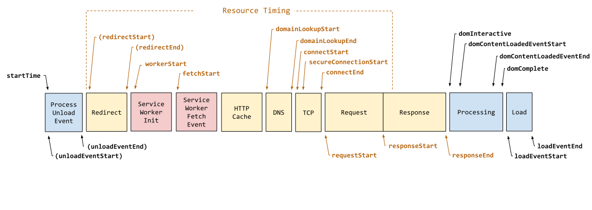

## 加载链路主线（基础）

### 从输入 URL 到页面加载完成



1. 卸载原页面并重定向到新页面：浏览器会准备一个`渲染进程`用于渲染即将到来的页面，和一个`网络进程`用于发送网络请求
2. 处理service worker：如果当前页面注册了Service Worker那么它可以拦截当前网站所有的请求，进行判断是否需要向远程发送网络请求
3. 网络请求阶段
   1. 缓存判断：
      1. 强缓存判断
      2. 强缓存不可用，等下方建立好连接再进行协商缓存判断（之前响应有返回etag、last-modify）

   2. DNS 解析IP：
      1. 本地缓存→系统缓存→本地域名服务器
      2. 本地服务器迭代→(根/顶级/权威服务器)

   3. TCP+TLS连接
      1. TCP 三次握手：确认双方收发能力，携带初始序列号
      2. HTTPS 再做 TLS 握手：非对称加密交换密钥、之后对称加密传输

   4. 发送 HTTP 请求与响应

4. 浏览器渲染阶段：解析 HTML/CSS 构建 DOM/CSSOM → 合成渲染树 → 布局（计算几何位置）→ 绘制 → 合成上屏

### 常见优化手段
1. **网络层｜目标：降低往返延迟、提升传输效率**
   1. 静态资源接入 CDN
   2. HTML no-cache 配置协商缓存；带hash长缓存
   3. preconnect / dns-prefetch 预连接域名，提前加载关键资源：preload
   4. 使用 HTTP2 / HTTP3
2. **资源层｜目标：调度资源优先级，让关键资源更快抵达**
   1. 减少产物体积：Tree Shaking、组件库按需加载
   2. 只加载必要资源：路由懒加载、组件异步加载、图片懒加载
   3. 第三方包单独分包
3. **渲染 / 运行时｜目标：降低渲染开销，稳定布局，控制 CLS**
   1. 框架-vue
      1. 状态下沉：将状态放到使用它的最小组件，缩小变更影响范围，避免顶层状态连带大量无关组件重渲染
      2. v-memo：缓存模板子树，依赖不变跳过 diff
      3. v-once：静态内容只渲染一次
      4. `shallowRef / shallowReactive`：大型数据关闭深层响应，降低代理开销
      5. 收敛 watch：精确监听字段，避免不必要 deep，及时销毁 watch
      6. 使用 `computed` 缓存昂贵派生计算
      7. Props 精简、保持引用稳定，不传递完整大对象
      8. 动静组件拆分，隔离高频更新区域
   2. 长列表使用虚拟列表
   3. 稳定布局、低成本动画
      1. 动画只用 `transform`、`opacity`，走合成层
      2. 动态内容提前预留容器尺寸，防止 CLS
4. **交互层｜目标：保护主线程，保证 INP，响应及时**
   1. 优化长任务：长任务使用 MessageChannel 切片、密集计算使用 web worker
   2. 防抖、节流
   3. `requestIdleCallback` 延迟挂载非关键组件
   4. 及时清理定时器、请求订阅、事件监听，避免内存泄漏

5. **数据 / 页面请求层｜目标：避免数据阻塞关键渲染路径**
   1. 消除/减少串行等待
   2. 接口去除、缓存
   3. 限制并发数量


## 指标驱动主线（进阶）

## 核心流程

1. 定基线：先采集线上RUM，同级 P75/P90等
2. 利用实验室工具定位瓶颈
3.  灰度验证对比结果，验证收益
4. 防劣化，如CI性能门禁、看板告警、CR check list

## 指标体系

### 核心指标（Core Web Vitals）

[web.dev](https://web.dev/performance?hl=zh-cn)

- LCP
  - 衡量最重要内容在网页上显示所需要的时间，≤ 2.5s ≤ 4.0s > 4.0s
  - LCP = TTFB + 资源加载延迟 + 资源加载时长 + 元素渲染延迟
  -  资源加载延迟：TTFB 到开始请求 LCP 资源时间，如果不需要为0
  - 资源加载时长：LCP 资源加载时间，如果不需要为0
  - 元素渲染延迟：LCP 渲染结束 - 资源加载结束
- INP
  - 衡量网页对用户输入的响应速度，200ms ≤ 500ms> 500ms
  - INP = 输入延迟 + 事件处理时长 + 呈现延迟
  - 输入延迟典型原因：主线程被长任务占用，用MessageChannel切片
  - 事件处理时长典型原因：同步计算重、重复渲染，用web worker, 节流防抖等
  - 呈现延迟典型原因：布局重排、样式重算、渲染排队
- CLS
  - 衡量网页的视觉稳定性，≤ 0.1 ≤ 0.25 > 0.25
  - 典型手段优化：预留尺寸、预留空间

### 辅助指标

- TTFB: 首字节时间
- FCP：首次内容绘制时间
- 长任务：50ms

## 指标采集

### 真实用户（RUM）

#### web-vitals

```
import { onLCP, onINP, onCLS } from 'web-vitals'

function sendToReport(metric) {
    // sendBeacon：页面卸载也能发出、不阻塞主线程
    navigator.sendBeacon('/api/report', JSON.stringify(metric))
}
onLCP(sendToReport)
onINP(sendToReport)
onCLS(sendToReport)
```

#### 自定义

```
const po = new PerformanceObserver((list) => {
  for (const entry of list.getEntries()) {
    report(entry.entryType, {
      name: entry.name,
      startTime: entry.startTime,
      duration: (entry as PerformanceEventTiming).duration
    })
  }
})
po.observe({ type: 'largest-contentful-paint', buffered: true })
po.observe({ type: 'layout-shift', buffered: true })
po.observe({ type: 'event', buffered: true })
po.observe({ type: 'longtask', buffered: true })
```


### 实验室

| 工具             | 替你做掉的事                   | 代价                   | 适合回答                   |
| ---------------- | ------------------------------ | ---------------------- | -------------------------- |
| Network / 瀑布图 | 请求按时间排好、标优先级与阻塞 | 只看搬运、不看计算     | 时间花在哪个资源等待上     |
| Performance      | 主线程采样、生成火焰图         | 录制有开销、体量大     | 那 500ms 在跑什么函数      |
| Coverage         | 每文件已用 / 总字节            | 只给静态结论           | 有多少代码下了没用         |
| Memory           | 堆快照 / 对比 / 分配时间线     | 快照暂停页面、体量大   | 越用越卡、什么没被回收     |
| Lighthouse       | 全套审计打分                   | 模拟环境、只代表这一次 | 整体水位、短板扫描         |
| WebPageTest      | 多地域 / 弱网模拟              | 环境搭建成本           | 真实设备、弱网下的瀑布对比 |
| Bundle Analyzer  | 包体积构成                     | 需接入构建             | 大依赖、重复依赖、CJS 依赖 |


