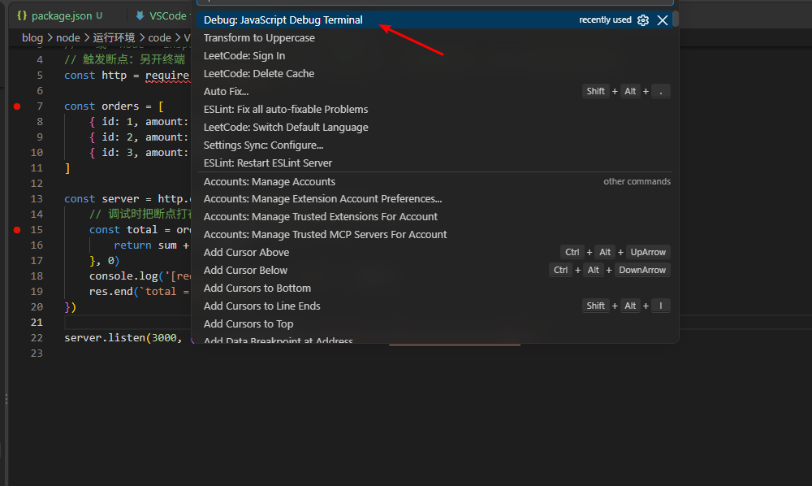
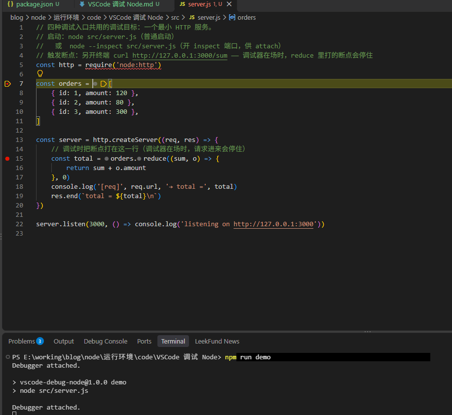
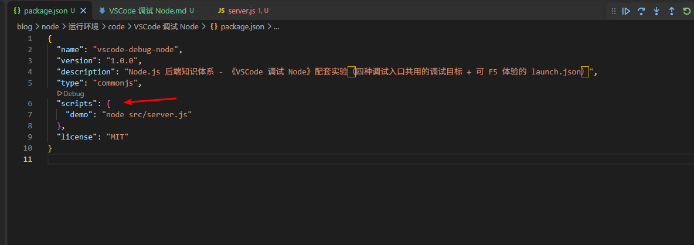
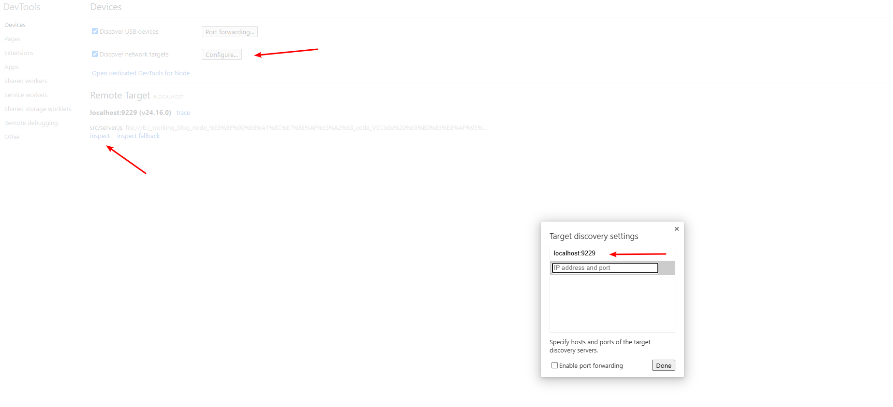
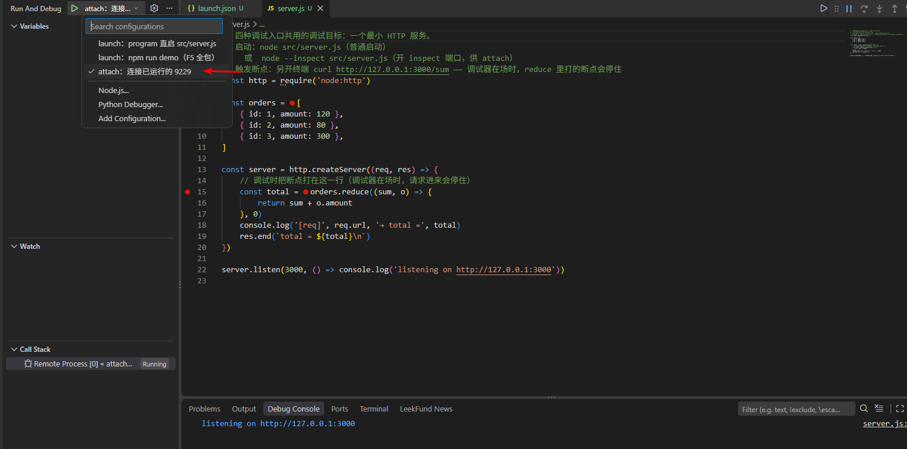

# VSCode 调试 Node

## 共用调试目标：`src/server.js`

> 摘自 `./code/VSCode 调试 Node/src/server.js`

```js
// 四种调试入口共用的调试目标：一个最小 HTTP 服务。
// 启动：node src/server.js（普通启动）
//   或  node --inspect src/server.js（开 inspect 端口，供 attach）
// 触发断点：另开终端 curl http://127.0.0.1:3000/sum —— 调试器在场时，reduce 里打的断点会停住
const http = require('node:http')

const orders = [
    { id: 1, amount: 120 },
    { id: 2, amount: 80 },
    { id: 3, amount: 300 },
]

const server = http.createServer((req, res) => {
    // 调试时把断点打在这一行（调试器在场时，请求进来会停住）
    const total = orders.reduce((sum, o) => {
        return sum + o.amount
    }, 0)
    console.log('[req]', req.url, '→ total =', total)
    res.end(`total = ${total}\n`)
})

server.listen(3000, () => console.log('listening on http://127.0.0.1:3000'))
```

它是常驻运行的 HTTP 服务——调试器在场时，`curl http://127.0.0.1:3000/sum` 就会停在 `reduce` 里的断点上，四种入口都能在同一份代码上完整走通。

## JavaScript Debug Terminal

- 启动 JavaScript Debug Terminal

  - 命令面板（`Ctrl+Shift+P`）→ **Debug: Create JavaScript Debug Terminal**
  - 通过这个面板启动程序

  

  

  

## package.json Debug



## attach Debug

- 通过 inspect 跑起来

```bash
PS E:\working\blog\node\运行环境\code\VSCode 调试 Node> node --inspect src/server.js
Debugger listening on ws://127.0.0.1:9229/d1c99abf-b188-4f75-9497-739d1818355c
For help, see: https://nodejs.org/learn/getting-started/debugging
listening on http://127.0.0.1:3000
```

- chrome 连接：chrome://inspect

  

- vscode 连接：配合launch.json

  

## launch.json Debug

launch.json 是工程调试的固定入口（配置可入库团队共享）。骨架三要素：`type` 固定 `"node"`（VSCode 内置 Node 调试器）、`request` 取 `launch` 或 `attach`、`name` 是调试下拉框里显示的名字。其余常用字段：

| 字段 | 作用 | 常见取值 |
| --- | --- | --- |
| `program` | 直启的 JS 入口（launch 最简形态，适合单文件脚本） | `${workspaceFolder}/src/index.js` |
| `runtimeExecutable` + `runtimeArgs` | 用指定可执行程序启动——走 npm scripts，**与工程启动链路（编译、环境变量、自检）完全对齐**，工程调试的正解 | `"npm"` + `["run", "demo"]`；Windows 下要写 `"npm.cmd"` |
| `cwd` | 进程工作目录 | `${workspaceFolder}` |
| `console` | 进程输出位置；`integratedTerminal` 在集成终端里跑，看得到完整启动日志 | `"internalConsole"` / `"integratedTerminal"` |
| `skipFiles` | 单步调试时跳过的文件 | `["<node_internals>/**"]`（不进 Node 内部源码） |
| `port` / `address` | attach 连接的 inspect 端口与地址（即上一小节 attach Debug 用的那条配置） | `9229` / `127.0.0.1` |
| `restart` | attach 时目标进程重启后**自动重连**（`nest start --watch` 这类热重启模式必备，否则每次重启后都要手动重连） | `true` |
| `sourceMaps` + `outFiles` | TS 工程实际跑的是 `dist` 产物，靠 sourcemap 把 `src` 上的断点映射过去 | `true` + `["${workspaceFolder}/dist/**/*.js"]` |

`${workspaceFolder}` 是 VSCode 的变量替换，指当前打开的工作区根——配置因此不写死任何绝对路径。

本仓库配套项目里有可直接 F5 体验的 `.vscode/launch.json`（需把 `code/VSCode 调试 Node` 本身作为工作区打开），两条 launch 配置正好对应上面两种写法：

```jsonc
{
    "version": "0.2.0",
    "configurations": [
        {
            // 写法一：program 直启 src/server.js，出生即带调试器
            "type": "node",
            "request": "launch",
            "name": "launch：program 直启 src/server.js",
            "program": "${workspaceFolder}/src/server.js",
            "skipFiles": ["<node_internals>/**"],
            "console": "integratedTerminal"
        },
        {
            // 写法二：npm scripts 形态，F5 全包
            "type": "node",
            "request": "launch",
            "name": "launch：npm run demo（F5 全包）",
            "runtimeExecutable": "npm",
            "windows": {
                "runtimeExecutable": "npm.cmd"
            },
            "runtimeArgs": ["run", "demo"],
            "cwd": "${workspaceFolder}",
            "console": "integratedTerminal",
            "skipFiles": ["<node_internals>/**"]
        },
        {
            // 上一小节 attach Debug 用的那条配置
            "type": "node",
            "request": "attach",
            "name": "attach：连接已运行的 9229",
            "address": "127.0.0.1",
            "port": 9229,
            "restart": true,
            "skipFiles": ["<node_internals>/**"]
        }
    ]
}
```

注意：VSCode 只加载**当前打开的工作区根目录**下的 `.vscode/launch.json`——以仓库根打开时，子目录里的 launch.json 完全不生效（调试下拉框里根本没有那条配置）。

## 配套代码

| 文件 | 对应小节 | 演示什么 |
| --- | --- | --- |
| `./code/VSCode 调试 Node/src/server.js` | 四种调试入口（`npm run demo`，常驻服务） | 共用调试目标：最小 HTTP 服务，调试器在场时 `curl http://127.0.0.1:3000/sum` 会停在 `reduce` 断点上 |
| `./code/VSCode 调试 Node/.vscode/launch.json` | attach Debug 与 launch.json Debug（把项目文件夹作为工作区打开后按 F5） | 三条配置：program 直启、runtimeExecutable 走 npm scripts、attach 连 9229 |

## 参考

- Node.js 官方文档：[Debugging Guide](https://nodejs.org/en/learn/getting-started/debugging)（--inspect / --inspect-brk / CDP）
- VSCode 官方文档：[Debugging in Visual Studio Code](https://code.visualstudio.com/docs/debugtest/debugging)（launch.json / attach / 断点类型）
